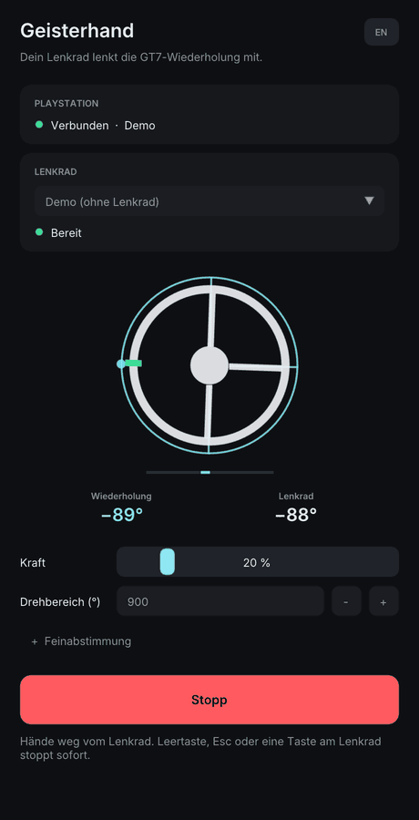
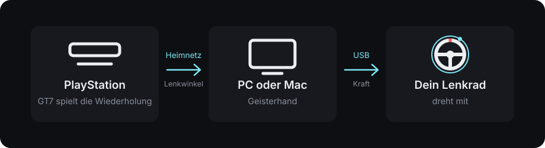
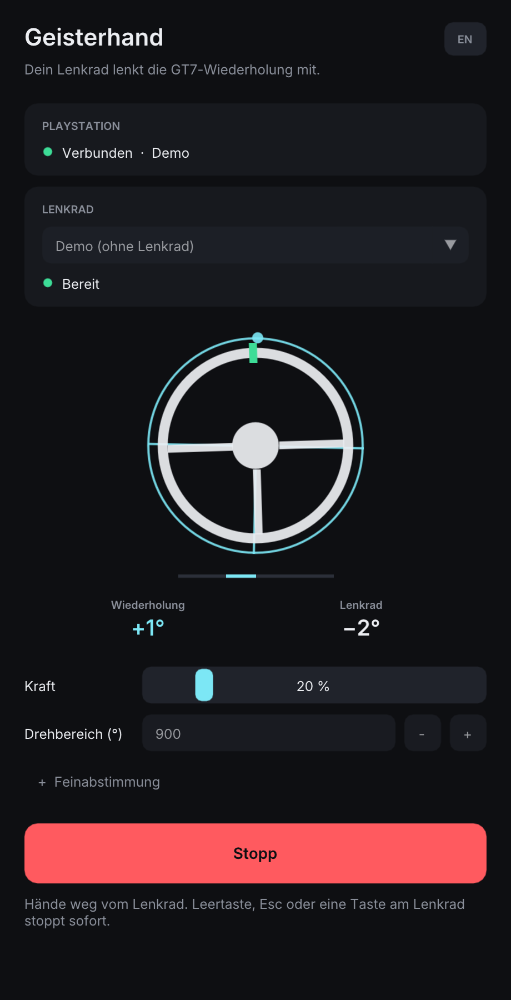
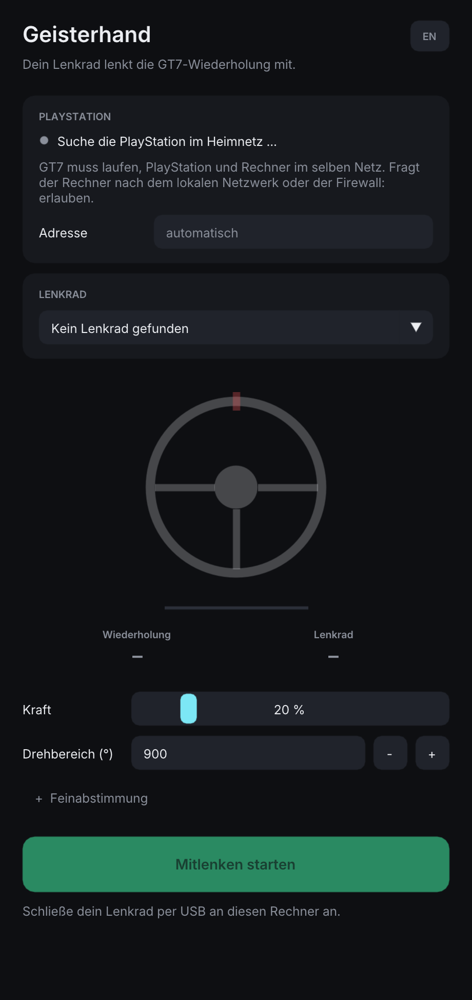

# Geisterhand

**Dein Lenkrad lenkt eine Wiederholung aus Gran Turismo 7 mit.** Die PlayStation spielt die
Wiederholung ab, ein kleines Programm auf deinem PC oder Mac hört mit, wie das Auto gelenkt
wird, und dein echtes Lenkrad dreht sich genauso – wie von Geisterhand. Sieh dir eine Runde
aus der Bestenliste an und schau zu, was die Schnellsten am Lenkrad tun.

<p align="center"></p>

*English version: [README.md](README.md)*

> **Frühe Fassung – bisher hat sie noch kein echtes Lenkrad gedreht.** Geprüft ist das
> Programm bislang gegen nachgebildete Lenkräder und eine nachgebaute Konsole, auf einem Mac
> und in einer virtuellen Maschine mit Windows 11. Die ersten Läufe an echter Hardware stehen
> noch aus; siehe [Was geprüft ist](#was-geprüft-ist). Ein Lenkrad mit Motor kann dich
> verletzen: Lies zuerst [Sicherheit](#sicherheit) und fang mit wenig Kraft an.

> **Inoffiziell.** Dieses Projekt steht in keiner Verbindung zu Sony Interactive
> Entertainment, Polyphony Digital oder einem Hersteller von Lenkrädern und wird von ihnen
> weder unterstützt noch gebilligt. „Gran Turismo“ und „PlayStation“ sind Marken ihrer
> jeweiligen Inhaber. Das Programm liest die Fahrdaten, die das Spiel auf Anfrage im lokalen
> Netz sendet; das Format ist vom Hersteller nicht dokumentiert und kann sich mit jedem Update
> des Spiels ändern oder verschwinden. Benutzung auf eigene Gefahr.

## So funktioniert es



1. Gran Turismo 7 sendet seine Fahrdaten ins Heimnetz – auch dann, wenn es eine Wiederholung
   abspielt. Dazu gehört der Winkel des Lenkrads, 60-mal in der Sekunde.
2. Geisterhand empfängt das auf deinem PC oder Mac.
3. Dein Lenkrad steckt an diesem Rechner, nicht an der PlayStation. Geisterhand liest, wo das
   Lenkrad steht, und drückt es mit seinem eigenen Motor dorthin, wo die Wiederholung es hat.

Es geht auch, während du selbst mit dem Controller fährst: Dann macht das Lenkrad auf deinem
Tisch, was dein Daumen macht. (Nach den Aufzeichnungen der Community lässt das Spiel den
Lenkwinkel im Sport-Modus weg.)

## Was du brauchst

- **Gran Turismo 7** auf einer PlayStation 5 oder PlayStation 4, in einer aktuellen Version.
- **Einen PC oder Mac im selben Heimnetz** wie die PlayStation: Windows 10 oder 11 (64 Bit)
  oder macOS 11 oder neuer (Apple Silicon oder Intel). Ein Netzwerkkabel ist besser als WLAN.
- **Ein Lenkrad mit Force Feedback, per USB an diesem Rechner** – siehe
  [Welche Lenkräder](#welche-lenkräder). Die Wiederholung startest du an der Konsole mit dem
  Controller.

## Start

**Windows 10 oder 11: das Programm als ZIP.** Lade
[Geisterhand-windows-x64.zip](https://github.com/qshiqshi/gt7-geisterhand/releases/latest/download/Geisterhand-windows-x64.zip),
entpacke es und starte `Geisterhand.exe` im Ordner. Es ist nicht signiert: Windows fragt beim
ersten Start nach (**Weitere Informationen** → **Trotzdem ausführen**).

**Mac (Apple Silicon oder Intel, gebaut für macOS 11 und neuer): die App.** Lade
[Geisterhand-mac.zip](https://github.com/qshiqshi/gt7-geisterhand/releases/latest/download/Geisterhand-mac.zip),
entpacke es per Doppelklick und zieh `Geisterhand` nach „Programme“. Die App ist noch nicht
von Apple beglaubigt, deshalb verweigert macOS den ersten Start: Öffne **Systemeinstellungen →
Datenschutz & Sicherheit**, scroll nach unten zu „Geisterhand“ und klick auf **Dennoch
öffnen**. (Bis macOS 14: Rechtsklick auf die App → **Öffnen**.)

**Oder bau es selbst** – ein Befehl, siehe [Bauen](#bauen).

Danach:

1. **Steck das Lenkrad an den Rechner.** Unter Windows installierst du vorher den Treiber des
   Herstellers (Logitech G HUB, den Thrustmaster- oder den Fanatec-Treiber) und stellst das
   Lenkrad auf PC-Betrieb, falls es dafür einen Schalter hat.
2. **Starte GT7 auf der PlayStation und spiel eine Wiederholung ab** – eine eigene oder eine
   aus der Bestenliste.
3. **Öffne Geisterhand.** Es findet die PlayStation von selbst und zeigt „Verbunden“. Fragt
   dein Rechner, ob das Programm das lokale Netzwerk benutzen (Mac) oder durch die Firewall
   darf (Windows): erlauben.
4. **Wähle dein Lenkrad** in der Liste und stell bei **Drehbereich** ein, was am Lenkrad
   eingestellt ist (oft 900 oder 1080 Grad).
5. **Hände weg vom Lenkrad, nichts im Weg – dann „Mitlenken starten“.** Das Lenkrad wird kurz
   angetippt, damit das Programm lernt, in welche Richtung eine Kraft es dreht, und folgt dann
   der Wiederholung.
6. **Stopp** mit der Leertaste, Esc, einer beliebigen Taste am Lenkrad, dem Stopp-Knopf oder
   indem du das Fenster schließt.

| Beim Mitlenken | Warten auf die PlayStation |
| :---: | :---: |
|  |  |

Der dünne türkise Ring mit dem Punkt ist das Lenkrad der Wiederholung, das weiße Lenkrad davor
ist deins. Der Balken darunter zeigt, was der Motor gerade tut. Die Bilder zeigen die eingebaute
Demo: eine erfundene Fahrt und ein nachgebildetes Lenkrad.

## Welche Lenkräder

Ein Programm kann ein Lenkrad nur drehen, wenn der Rechner einen Weg zu dessen Motor hat. Der
ist unter Windows und macOS verschieden, deshalb gibt es zwei Tabellen. Nichts davon ist bisher
an echter Hardware ausprobiert – „erwartet“ heißt: Das ist der Weg, den das Lenkrad anbietet,
und das Programm benutzt ihn.

**Windows** – jedes Lenkrad, dessen Treiber Force Feedback anbietet, so wie es Rennspiele am PC
nutzen (DirectInput):

| Lenkrad | Braucht | Stand |
| --- | --- | --- |
| Logitech G29, G923, G PRO, RS50 | Logitech G HUB | erwartet |
| Thrustmaster T128, T150, T248, T300 RS, T-GT II, T598 | Thrustmaster-Treiber, PC-Betrieb | erwartet |
| Fanatec GT DD Pro, CSL DD, ClubSport DD, Podium | Fanatec-Treiber, PC-Betrieb | erwartet |
| Jedes andere Lenkrad mit Force-Feedback-Treiber für Windows | dessen Treiber | erwartet |

**macOS** – dort bieten nur wenige Hersteller einen Weg zum Motor:

| Lenkrad | Wie | Stand |
| --- | --- | --- |
| Logitech RS50, G PRO | direkt über USB, ohne Treiber | erwartet |
| Logitech G29 (Schalter am Lenkrad auf PS3), G27, G25, Driving Force GT / Pro / EX | Treiber steckt im Programm (SDL) | erwartet |
| Jedes Lenkrad, das einen Force-Feedback-Treiber für macOS mitbringt | dessen Treiber | erwartet |
| Logitech G923 | – | noch nicht |
| Thrustmaster, Fanatec | – | nicht möglich: Für sie gibt es keinen Force-Feedback-Treiber für macOS |

Lenkräder, die das Programm sieht, aber nicht drehen kann, stehen mit dem Zusatz „ohne Force
Feedback“ in der Liste. Lenkräder ohne Motor (zum Beispiel Thrustmaster T80, Hori Apex) kann
nichts drehen.

Wenn du ein Lenkrad ausprobierst, [schreib bitte, wie es lief](#mitmachen) – so bekommen diese
Tabellen ihr erstes „läuft“.

## Einstellungen

- **Kraft** – wie stark der Motor höchstens drücken darf, als Anteil dessen, was das Lenkrad
  kann. Voreingestellt sind 20 %. Schwache Lenkräder (mit Zahnrädern oder Riemen) brauchen
  manchmal mehr, um mitzukommen; bei einem starken Direktantrieb bleib niedrig.
- **Drehbereich (°)** – von Anschlag zu Anschlag, genau wie am Lenkrad eingestellt. Dreht das
  Lenkrad weiter oder weniger weit als die Wiederholung, stimmt diese Zahl nicht.
- **Feinabstimmung**
  - *Richtung umkehren* – wenn das Lenkrad nach links dreht, wo die Wiederholung nach rechts
    lenkt.
  - *Lenkfaktor* – wie weit das Lenkrad im Vergleich zur Wiederholung dreht (1,00 = gleich).
  - *Straffheit* – wie fest das Lenkrad am Winkel der Wiederholung gehalten wird. Das Programm
    tastet selbst ab, wie viel jedes Lenkrad verträgt, und nimmt zurück, sobald es zittert;
    das hier ist die Feinjustierung obendrauf.
  - *Puffer* – Pakete kommen im Heimnetz ungleichmäßig an. Das Programm spielt sie etwas
    später (voreingestellt 80 ms) und gleichmäßig ab. Mehr hilft, wenn das Lenkrad ruckt.

## Sicherheit

Ein Lenkrad mit Force Feedback ist ein Motor mit einem Hebel dran. Ein Direktantrieb ist stark
genug, um einen Daumen zu brechen.

Was das Programm tut:

- Es beginnt mit wenig Kraft und steigert sie sanft; das Lenkrad soll nie schneller drehen,
  als ein flinker Fahrer lenkt.
- Bevor es mitlenkt, wartet es, bis das Lenkrad stillsteht, tippt es an und lernt so, in
  welche Richtung eine Kraft es dreht. Bewegt sich nichts, startet es nicht.
- Es stoppt sofort und gibt das Lenkrad frei bei **jeder Taste am Lenkrad**, bei Leertaste
  oder Esc (wenn das Fenster vorn ist), dem Stopp-Knopf oder wenn das Fenster geschlossen wird.
- Es stoppt von selbst, wenn das Lenkrad gegen die Kraft läuft (jemand hält es fest, oder die
  Richtung stimmt nicht), zu schnell dreht, sich bei voller Kraft nicht bewegt (etwas
  blockiert) oder dauerhaft zittert.
- Bleiben die Daten aus (Wiederholung zu Ende, Netz weg), verschwindet die Kraft und das
  Lenkrad ist frei. Nach zehn Sekunden ohne Daten stoppt es ganz, damit das Lenkrad nicht
  überraschend losdreht, wenn die nächste Wiederholung beginnt.
- Der Teil, der das Lenkrad antreibt, läuft getrennt vom Fenster: Ein Fenster, das gerade
  verschoben wird oder hängt, lässt keine Kraft stehen.

Was du tust:

- **Hände weg vom Lenkrad**, solange es mitlenkt, und halte Kabel, Kopfhörer, Kinder und
  Haustiere vom Lenkradkranz fern.
- Fang mit der geringen Kraft an. Erhöhe sie nur so weit, wie das Lenkrad zum Mitkommen
  braucht.
- Lass es nicht unbeaufsichtigt laufen.

Es gibt keine Gewährleistung; du benutzt es auf eigene Gefahr.

## Wenn etwas nicht klappt

- **„Suche die PlayStation im Heimnetz …“ bleibt stehen.** Läuft GT7? Sind Konsole und Rechner
  im selben Netz (kein Gäste-WLAN)? Mac: *Systemeinstellungen → Datenschutz & Sicherheit →
  Lokales Netzwerk* → Geisterhand erlauben. Windows: das Programm bei der Firewall-Frage
  zulassen. Oder trag die Adresse der Konsole ins Feld ein (PlayStation: *Einstellungen →
  Netzwerk → Verbindungsstatus anzeigen*).
- **„Port 33740 ist belegt.“** Pro Rechner kann nur ein Programm die Fahrdaten des Spiels
  empfangen. Beende das andere (GT7 Companion, SimHub, eine Dashboard-App …).
- **„Verbunden, aber ohne Lenkwinkel.“** Ein anderes Programm hat beim Spiel zuerst das kurze
  Paketformat angefordert. Beende es und warte etwa zehn Sekunden.
- **Das Lenkrad steht mit „ohne Force Feedback“ in der Liste.** Windows: Treiber des
  Herstellers installieren und das Lenkrad auf PC-Betrieb stellen. Mac: siehe
  [Welche Lenkräder](#welche-lenkräder).
- **„Das Lenkrad reagiert nicht auf Kraft.“** Erhöhe die Kraft und prüfe, ob Force Feedback
  im Treiber des Lenkrads ausgeschaltet oder auf null gestellt ist.
- **Das Lenkrad dreht falsch herum, zu weit oder zu wenig.** *Richtung umkehren*,
  *Drehbereich* und *Lenkfaktor* oben.
- **Das Lenkrad ruckt.** Nimm ein Netzwerkkabel oder erhöhe den *Puffer*.
- **Das Lenkrad zittert.** Verringere die *Kraft* oder die *Straffheit*.
- **Zurück an der PlayStation verhält sich das Lenkrad seltsam.** Schalte die Lenkradbasis
  einmal aus und wieder ein.

## Was geprüft ist

- Die Entschlüsselung der Pakete des Spiels gegen Pakete aus einer unabhängigen Umsetzung, und
  der ganze Empfangsweg gegen eine nachgebaute Konsole, die einen echten Mitschnitt abspielt.
- Die Regelung gegen nachgebildete Lenkräder vom Zahnrad-Lenkrad mit 2 Nm bis zum
  Direktantrieb mit 25 Nm, mit beiden Kraftrichtungen, langsamen Treibern und stoßweisem Netz –
  samt allen Fällen, in denen sie sich selbst abschalten muss (`Geisterhand --selftest`).
- Das Programm unter macOS 27 (Apple Silicon) und, für Windows gebaut, in einer virtuellen
  Maschine mit Windows 11: Selbsttest, Fenster, Demo, Netzwerk.

Noch nicht geprüft: irgendein echtes Lenkrad, eine echte PlayStation mit diesem Programm, ein
echter Windows-PC, ein Intel-Mac. Die Liste steht in [STATUS.md](STATUS.md).

<p align="center"></p>

## Mitmachen

Rückmeldungen helfen am meisten – vor allem von echten Lenkrädern.

- Was hat geklappt, was nicht? Schreib es als
  [Issue](https://github.com/qshiqshi/gt7-geisterhand/issues/new) – auf Deutsch oder Englisch.
- Hilfreich: dein Lenkrad und wie es angeschlossen ist, Windows oder Mac samt Version, deine
  Konsole, die eingestellte Kraft und die Zeile, die das Programm beim Stoppen gezeigt hat.

## Bauen

Du brauchst CMake und Ninja; der erste Bau lädt SDL 3 und Dear ImGui herunter (ihre
Prüfsummen werden geprüft).

```sh
./build.sh mac        # dist/mac/Geisterhand.app, für Apple Silicon und Intel
./build.sh windows    # dist/windows/Geisterhand.exe; am Mac braucht das: brew install mingw-w64
```

Unter Windows selbst sollte es sich mit CMake und einem C++17-Compiler bauen lassen
(`cmake -B build && cmake --build build`); das ist noch nicht ausprobiert.

Zum Ausprobieren ganz ohne Hardware:

```sh
dist/mac/Geisterhand.app/Contents/MacOS/Geisterhand --selftest      # alle Prüfungen, ohne Fenster
dist/mac/Geisterhand.app/Contents/MacOS/Geisterhand --demo           # erfundene Fahrt, nachgebildetes Lenkrad
python3 tools/fake_ps5.py                                            # eine nachgebaute PlayStation, siehe Dateikopf
```

Der Quelltext ist klein: `src/telemetry.cpp` empfängt und entschlüsselt, `src/playout.cpp`
gleicht die Ankunft aus, `src/controller.cpp` ist die Regelung mit ihren Wächtern,
`src/wheel.cpp` spricht mit den Lenkrädern, `src/engine.cpp` ist der Thread, der alles
zusammenführt, und `src/main.cpp` ist das Fenster.

## Datenschutz

Das Programm spricht mit deiner PlayStation im Heimnetz und mit deinem Lenkrad. Es sendet
nichts ins Internet. Seine wenigen Einstellungen liegen in deinem Benutzerordner
(`qshi/Geisterhand`).

## Lizenz

Copyright © 2026 qshi. Freie Software unter der
[GNU General Public License, Version 3 oder später](LICENSE): Du darfst sie benutzen,
untersuchen, weitergeben und ändern; geänderte Fassungen, die du weitergibst, müssen unter
derselben Lizenz frei bleiben. Es gibt keine Gewährleistung.

Mitgelieferte Bestandteile anderer behalten ihre eigenen Lizenzen, siehe
[THIRD_PARTY_NOTICES.md](THIRD_PARTY_NOTICES.md) – dort stehen auch die Projekte, auf deren
veröffentlichtem Wissen dieses Programm aufbaut.
