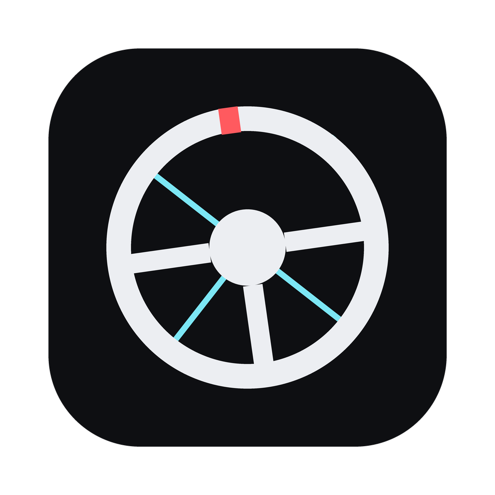
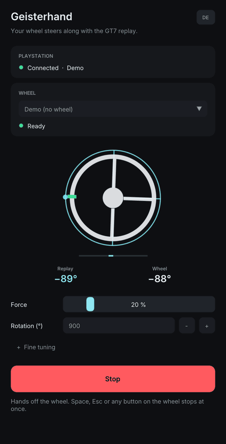
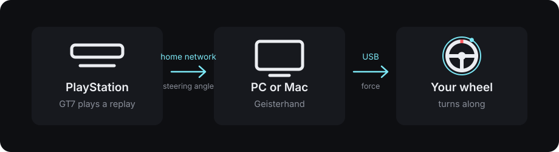
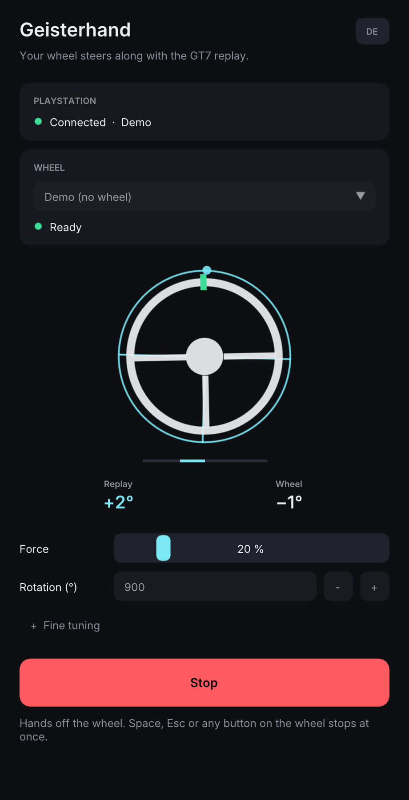
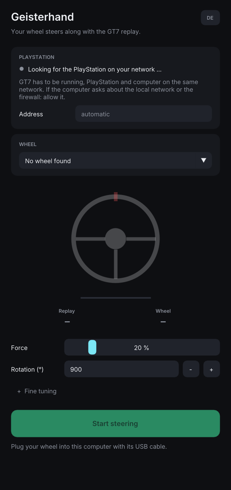
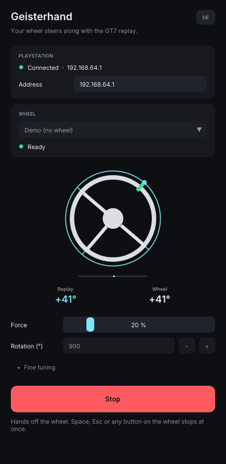

# Geisterhand

**Your steering wheel steers along with a Gran Turismo 7 replay.** The PlayStation plays the
replay, a small program on your PC or Mac listens to how the car is being steered, and your
real wheel turns the same way – as if a ghost had its hands on it ("Geisterhand" is German for
ghost hand). Watch a leaderboard lap and see what the fastest drivers do with the wheel.

<p align="center"></p>

*Deutsche Fassung: [README.de.md](README.de.md)*

> **Early version – no real wheel has been turned by it yet.** So far the program has been
> tested against simulated wheels and a stand-in console, on a Mac and in a Windows 11 virtual
> machine. The first runs on real hardware are still to come; see
> [what has been tested](#what-has-been-tested). A steering wheel with a motor can hurt you:
> read [Safety](#safety) first and start with a low force.

> **Unofficial.** This project is not affiliated with, endorsed by or connected to Sony
> Interactive Entertainment, Polyphony Digital or any maker of steering wheels. "Gran Turismo"
> and "PlayStation" are trademarks of their respective owners. The program reads the telemetry
> that the game sends on request in the local network; the format is not documented by the
> publisher and may change or disappear with any update of the game. Use at your own risk.

## How it works



1. Gran Turismo 7 sends its telemetry into the home network – also while it plays a replay.
   Part of it is the angle of the steering wheel, 60 times a second.
2. Geisterhand receives that on your PC or Mac.
3. Your wheel is plugged into that computer, not into the PlayStation. Geisterhand reads where
   the wheel is and pushes it with its own motor to where the replay has it.

It also works while you drive yourself with the controller: then the wheel on your desk does
what your thumb does. (According to the community's notes the game leaves the steering angle
out in Sport mode.)

## What you need

- **Gran Turismo 7** on a PlayStation 5 or PlayStation 4, in a current version.
- **A PC or Mac in the same home network** as the PlayStation: Windows 10 or 11 (64-bit), or
  macOS 11 or newer (Apple silicon or Intel). A network cable is better than Wi-Fi.
- **A steering wheel with force feedback, plugged into that computer by USB** – see
  [Which wheels](#which-wheels). To start the replay on the console you use the controller.

## Start

There are no downloads yet. Until there are, build the program yourself – it is one command,
see [Build](#build).

1. **Plug the wheel into the computer.** On Windows install the maker's driver first (Logitech
   G HUB, the Thrustmaster or the Fanatec driver) and set the wheel to its PC mode if it has
   one.
2. **Start GT7 on the PlayStation and play a replay** – one of your own or one from a
   leaderboard.
3. **Open Geisterhand.** It finds the PlayStation by itself and shows "Connected". If your
   computer asks whether the program may use the local network (Mac) or pass the firewall
   (Windows): allow it.
4. **Choose your wheel** in the list, and set **Rotation** to what is set on the wheel
   (often 900 or 1080 degrees).
5. **Hands off the wheel, nothing in its way – then "Start steering".** The wheel is nudged
   for a moment, so that the program learns which way a force turns it, and then follows the
   replay.
6. **Stop** with the space bar, Esc, any button on the wheel, the Stop button, or by closing
   the window.

| Following a replay | Waiting for the PlayStation |
| :---: | :---: |
|  |  |

The thin cyan ring with the dot is the replay's wheel, the white wheel in front of it is
yours. The bar underneath shows what the motor is doing. The pictures show the built-in demo:
a made-up drive and a simulated wheel.

## Which wheels

A wheel can only be turned by a program if the computer has a way to address its motor. That
differs between Windows and macOS, so the two get a table each. Nothing in these tables has
been tried on real hardware yet – "expected" means: this is the path the wheel offers, and
the program uses it.

**Windows** – every wheel whose driver offers force feedback, the way PC racing games use it
(DirectInput):

| Wheel | Needs | Status |
| --- | --- | --- |
| Logitech G29, G923, G PRO, RS50 | Logitech G HUB | expected |
| Thrustmaster T128, T150, T248, T300 RS, T-GT II, T598 | Thrustmaster driver, PC mode | expected |
| Fanatec GT DD Pro, CSL DD, ClubSport DD, Podium | Fanatec driver, PC mode | expected |
| Any other wheel with a force feedback driver for Windows | its driver | expected |

**macOS** – only a few makers offer a way to reach the motor there:

| Wheel | How | Status |
| --- | --- | --- |
| Logitech RS50, G PRO | directly over USB, no driver needed | expected |
| Logitech G29 (switch on the wheel set to PS3), G27, G25, Driving Force GT / Pro / EX | driver built into the program (SDL) | expected |
| Any wheel that comes with a force feedback driver for macOS | its driver | expected |
| Logitech G923 | – | not yet |
| Thrustmaster, Fanatec | – | not possible: there is no macOS force feedback driver for them |

Wheels the program can see but not turn are listed with the note "no force feedback". Wheels
without a motor (for example Thrustmaster T80, Hori Apex) cannot be turned by anything.

If you try a wheel, please [tell how it went](#join-in) – that is how these tables get their
first "works".

## Settings

- **Force** – the most the motor may push, as a share of what the wheel can do. It starts at
  20 %. Weak wheels (gear- or belt-driven) may need more to keep up; with a strong direct
  drive wheel stay low.
- **Rotation (°)** – lock to lock, exactly as it is set on the wheel. If the wheel turns
  further or less far than the replay, this number is wrong.
- **Fine tuning**
  - *Reverse direction* – if the wheel turns left where the replay turns right.
  - *Steering factor* – how far the wheel turns compared with the replay (1.00 = the same).
  - *Stiffness* – how tightly the wheel is held on the replay's angle. The program feels out
    by itself how much each wheel takes and backs off when it starts to tremble; this is a
    trim on top.
  - *Buffer* – packets in a home network arrive unevenly. The program plays them back a
    little later (80 ms by default) and evenly. More helps when the wheel moves in jerks.

## Safety

A force feedback wheel is a motor with a lever on it. A direct drive wheel is strong enough to
break a thumb.

What the program does:

- It starts with a low force and brings it up gently; the wheel is never asked to turn faster
  than a quick driver would.
- Before it follows, it waits until the wheel stands still and nudges it to learn which way a
  force turns it. If nothing moves, it does not start.
- It stops and releases the wheel at once on **any button on the wheel**, on the space bar or
  Esc (with the window in front), the Stop button or when the window is closed.
- It stops by itself when the wheel moves against the force (somebody holds it, or the
  direction is wrong), turns too fast, does not move at full force (something blocks it), or
  keeps shaking.
- When the data stops (replay over, network gone) the force goes away and the wheel is free.
  After ten seconds without data it stops altogether, so that the wheel does not start by
  surprise when the next replay begins.
- The part that drives the wheel runs separately from the window: a window that is being
  dragged or hangs does not leave a force standing.

What you do:

- **Hands off the wheel** while it follows, and keep cables, headphones, children and pets
  away from the rim.
- Start with the low force. Raise it only as far as the wheel needs to keep up.
- Do not leave it running unattended.

There is no warranty; you use it at your own risk.

## If something does not work

- **"Looking for the PlayStation …" does not go away.** Is GT7 running? Are console and
  computer in the same network (not a guest Wi-Fi)? Mac: *System Settings → Privacy &
  Security → Local Network* → allow Geisterhand. Windows: allow the program in the firewall
  question. Or type the console's address into the field (PlayStation: *Settings → Network →
  View Connection Status*).
- **"Port 33740 is in use."** Only one program per computer can receive the game's telemetry.
  Close the other one (GT7 Companion, SimHub, a dashboard app …).
- **"Connected, but without the steering angle."** Another program asked the game for the
  short packet format first. Close it and wait about ten seconds.
- **The wheel is listed with "no force feedback".** Windows: install the maker's driver and
  set the wheel to PC mode. Mac: see [Which wheels](#which-wheels).
- **"The wheel does not answer to force."** Raise the force, and check that force feedback is
  not switched off or set to zero in the wheel's driver.
- **The wheel turns the wrong way, too far or not far enough.** *Reverse direction*,
  *Rotation* and *Steering factor* above.
- **The wheel moves in jerks.** Use a network cable, or raise the *Buffer*.
- **The wheel trembles.** Lower the *Force* or the *Stiffness*.
- **Back on the PlayStation the wheel behaves oddly.** Switch the wheel base off and on once.

## What has been tested

- The decryption of the game's packets against packets made by an independent implementation,
  and the whole receiving path against a stand-in console that plays a real recording.
- The control loop against simulated wheels from a 2 Nm gear-driven one to a 25 Nm direct
  drive, with either force direction, slow drivers and bursty network – including every case
  in which it has to switch itself off (`Geisterhand --selftest`).
- The program on macOS 27 (Apple silicon) and, as built for Windows, in a Windows 11 virtual
  machine: self-test, window, demo, network.

Not tested yet: any real steering wheel, a real PlayStation with this program, a real Windows
PC, an Intel Mac. See [STATUS.md](STATUS.md) for the list.

<p align="center"></p>

## Join in

Feedback helps most – above all from real wheels.

- What worked, what did not? Write it as an
  [issue](https://github.com/qshiqshi/gt7-geisterhand/issues/new) – in English or German.
- Helpful: your wheel and how it is connected, Windows or Mac and the version, your console,
  the force you used, and the line the program showed when it stopped.

## Build

You need CMake and Ninja; the first build downloads SDL 3 and Dear ImGui (their hashes are
checked).

```sh
./build.sh mac        # dist/mac/Geisterhand.app, for Apple silicon and Intel
./build.sh windows    # dist/windows/Geisterhand.exe; on a Mac this needs: brew install mingw-w64
```

On Windows itself it should build with CMake and a C++17 compiler
(`cmake -B build && cmake --build build`); that has not been tried yet.

To try it without any hardware:

```sh
dist/mac/Geisterhand.app/Contents/MacOS/Geisterhand --selftest      # all checks, no window
dist/mac/Geisterhand.app/Contents/MacOS/Geisterhand --demo           # made-up drive, simulated wheel
python3 tools/fake_ps5.py                                            # a stand-in PlayStation, see its head
```

The source is small: `src/telemetry.cpp` receives and decrypts, `src/playout.cpp` evens out
the arrival, `src/controller.cpp` is the control loop with its watchdogs, `src/wheel.cpp`
talks to the wheels, `src/engine.cpp` is the thread that ties them together, and
`src/main.cpp` is the window.

## Privacy

The program talks to your PlayStation in the home network and to your wheel. It sends nothing
to the internet. Its few settings are stored in your user folder (`qshi/Geisterhand`).

## Licence

Copyright © 2026 qshi. Free software under the
[GNU General Public License, version 3 or later](LICENSE): you may use, study, share and change
it; changed versions that you pass on must stay free under the same licence. There is no
warranty.

Bundled parts by others keep their own licences, see
[THIRD_PARTY_NOTICES.md](THIRD_PARTY_NOTICES.md) – it also names the projects whose published
knowledge this program builds on.
